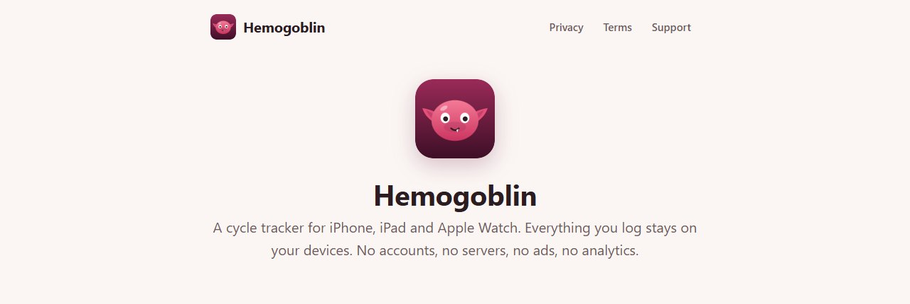
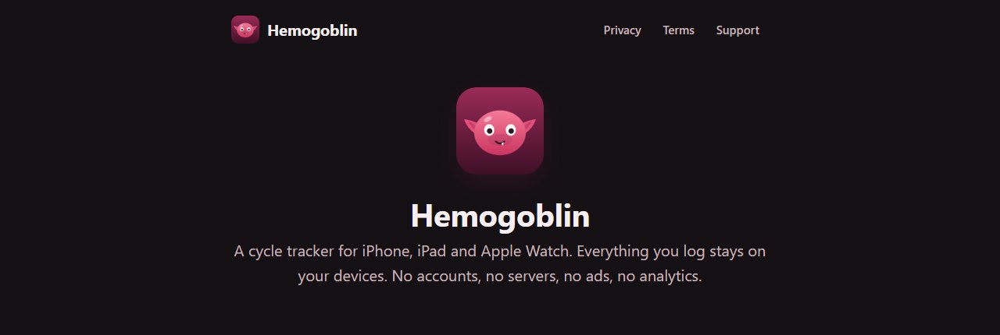
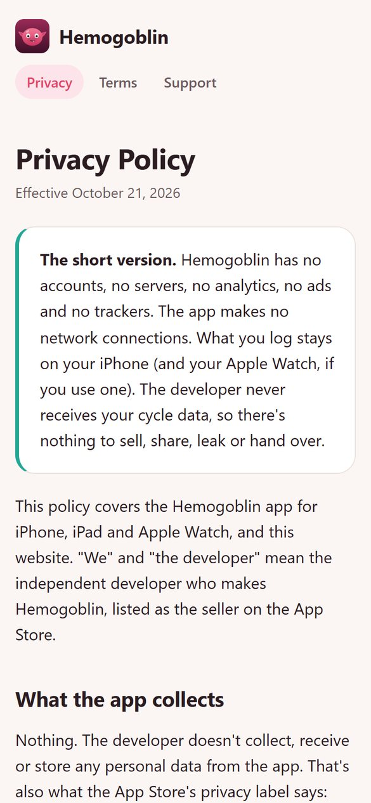
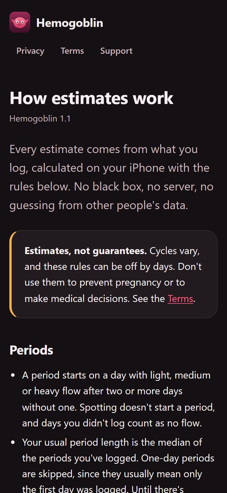
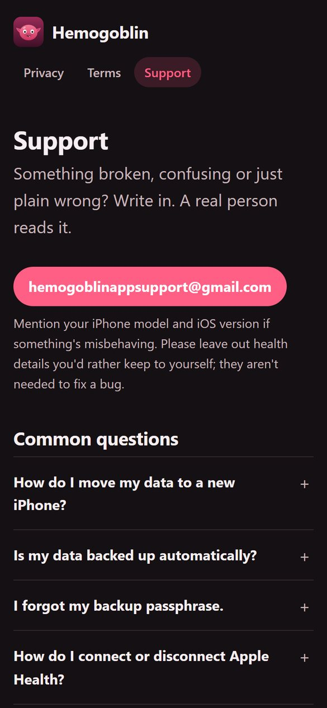

# Hemogoblin

**The website for Hemogoblin, a cycle tracker for iPhone, iPad and Apple Watch.**

The privacy policy, the terms of use, the support page and every rule behind the app's estimates,
served by GitHub Pages at **[chungus-actual.github.io/hemogoblin](https://chungus-actual.github.io/hemogoblin/)**.
The app's source isn't here.

---

## The pages

| Page | Address | What it covers |
|---|---|---|
| **Home** | [/](https://chungus-actual.github.io/hemogoblin/) | What Hemogoblin is, and a card for each page below |
| **Privacy Policy** | [/privacy/](https://chungus-actual.github.io/hemogoblin/privacy/) | No accounts, no servers, no analytics, no ads, no trackers; the app makes no network connections and the developer never receives cycle data |
| **Terms of Use** | [/terms/](https://chungus-actual.github.io/hemogoblin/terms/) | Not a medical device and not birth control; the license is Apple's standard EULA, which these terms add to |
| **Support** | [/support/](https://chungus-actual.github.io/hemogoblin/support/) | The support address and common questions: moving to a new iPhone, backups and passphrases, Apple Health, the Watch |
| **How estimates work** | [/estimates/](https://chungus-actual.github.io/hemogoblin/estimates/) | Every rule behind every date the app shows, for Hemogoblin 1.1 |

## On a phone

| | | |
|:---:|:---:|:---:|
|  Privacy Policy, light |  How estimates work, dark |  Support, dark |

## How it's built

| | |
|---|---|
| **Files** | One `index.html` per page, a shared `style.css` and `icon.svg` |
| **Scripts** | None; the support questions open with plain `
` |
| **Requests** | None to third parties: no web fonts, CDNs or analytics. The only links out are Apple's standard EULA and GitHub's privacy statement |
| **Themes** | Light and dark, following the system setting (`prefers-color-scheme`) |
| **Hosting** | GitHub Pages from `main`, repository root; `.nojekyll` serves the files as they are |

## Editing

| Task | How |
|---|---|
| Preview | Open `index.html` in a browser, or `python3 -m http.server` in the repository and visit `localhost:8000` |
| Publish | Push to `main`; Pages redeploys within a minute or two |
| Change a policy | Update the "Effective" date at the top of `privacy/` or `terms/` along with the wording |
| Change an estimate rule | Update `estimates/` together with the app release that changes the rule, and its version line |

`readme/` holds the images on this page. Pages serves it like any other folder; no page links to it.

## Contact

[hemogoblinappsupport@gmail.com](mailto:hemogoblinappsupport@gmail.com)
